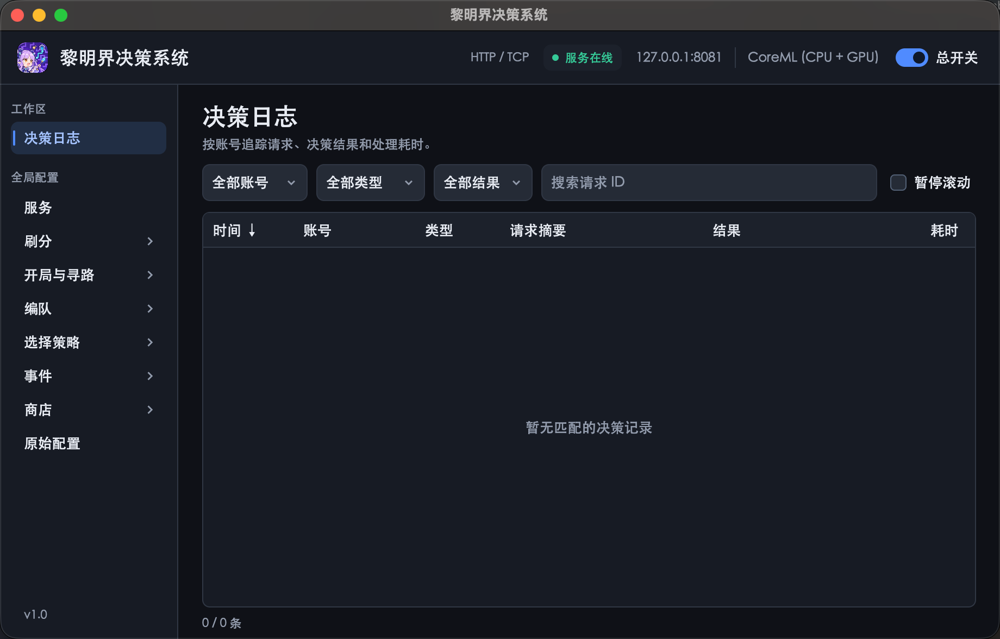

  

<h1 align="center">黎明界决策系统</h1>

面向《公主连结 Re:Dive》黎明界的本地决策服务，提供编队、寻路和选择建议，并配有策略配置与日志查看界面。

> **本项目是决策系统，仅提供决策，不是一键化自动工具。**
>
> 本系统接收客户端状态并返回建议，不负责登录、点击或执行游戏操作。

使用 C++20、ONNX Runtime 和 Slint 构建。客户端通过 JSON 协议提交游戏状态，服务端计算并返回决策。

在老虎机过三关的情况下，救济院通关分数最高可达 **53,000 分**。

## 功能

- **自动编队**：生成候选队伍，按模型预测结果排序，可接入 MZQ 模拟器验证。
- **开局与寻路**：按首领名单和区域条件筛选开局、搜索路线。
- **角色与遗物选择**：评估候选角色，设置自选券、属性券和遗物的选择顺序。
- **商店与事件**：规划购买方案，按配置选择事件选项。
- **刷分与清票**：按目标分数、保留票数和公会配置，判断是否继续或重新开局。
- **决策日志**：按帐号查看请求、结果、时间和耗时。

## 界面预览

## 使用

1. 从仓库的 **Releases** 下载最新版本的 `labyrinth-windows-x64.zip`，完整解压。
2. 打开 `黎明界决策系统.exe`，等待顶部显示「服务在线」。
3. 在左侧配置策略，点击「保存配置」。接入兼容客户端后，在「决策日志」查看请求与结果。

默认监听地址为 `127.0.0.1:8081`。Windows 模拟器连接前需开启 ADB 调试，运行包内的 `adb_reverse.cmd` 建立端口转发，详见 [Windows 使用说明](docs/README-windows.md)。

命令行入口为 `labyrinth_server`（Windows 为 `labyrinth_server.exe`），通过 `--help` 查看参数。GUI 和命令行服务使用同一端口时，只需启动其中一个。

## 配置与接入

配置保存在程序旁的 [`config/labyrinth.json`](config/labyrinth.json)。桌面界面支持保存后重载策略和模型；命令行服务修改配置后需重启。

客户端通过 `POST http://127.0.0.1:8081/labyrinth/decision` 提交 UTF-8 JSON 请求，`protocol_version` 为 `1`。`uid` 请求头填写帐号的 ViewerId，用于区分日志。无需执行操作时返回 `action: "noop"`。

## 文档

- [API 接口说明](docs/api.md)：请求字段、决策类型、返回动作与截图上传。
- [决策算法](docs/technical-reference.md)：编队、角色选择、寻路和商店等决策的算法说明。
- [Windows 使用说明](docs/README-windows.md)：启动、模拟器连接和多设备选择。

## 许可证

本项目采用 [GNU AGPL v3.0](LICENSE)（`AGPL-3.0-only`）。第三方组件按各自许可分发，详见 [第三方声明](third_party/THIRD_PARTY_NOTICES.txt)。
